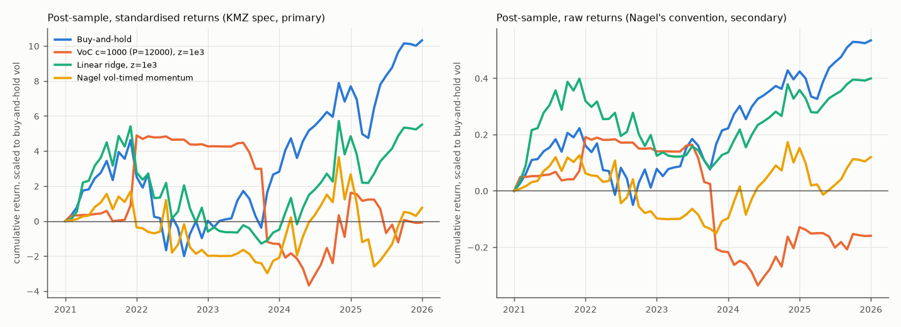
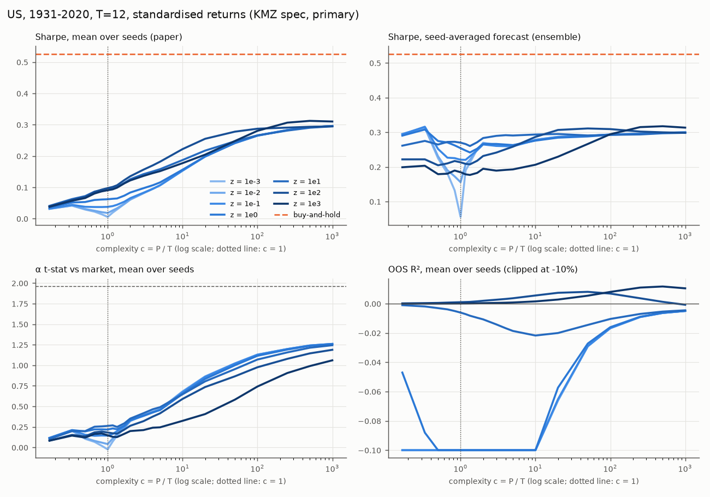
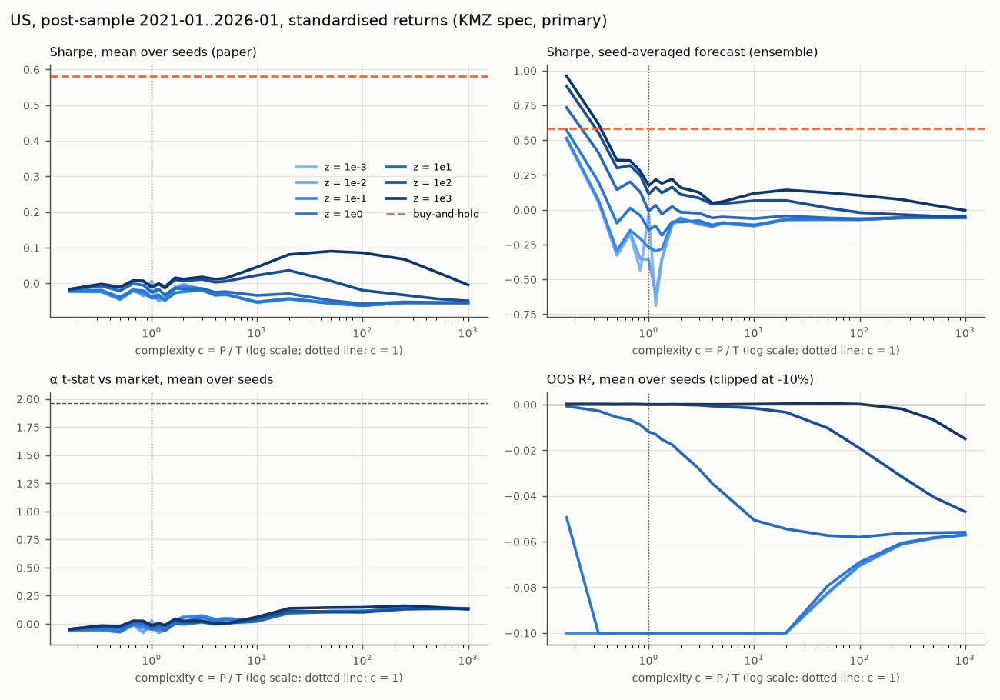
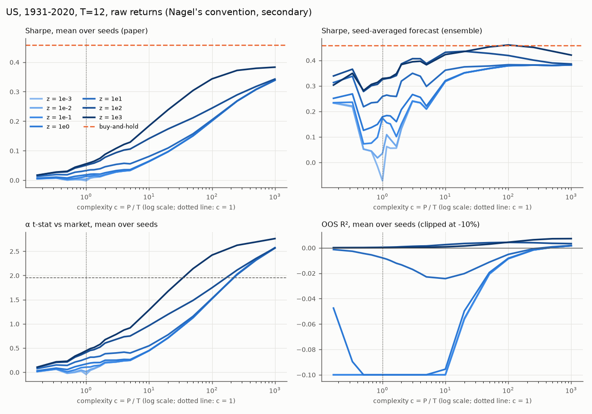
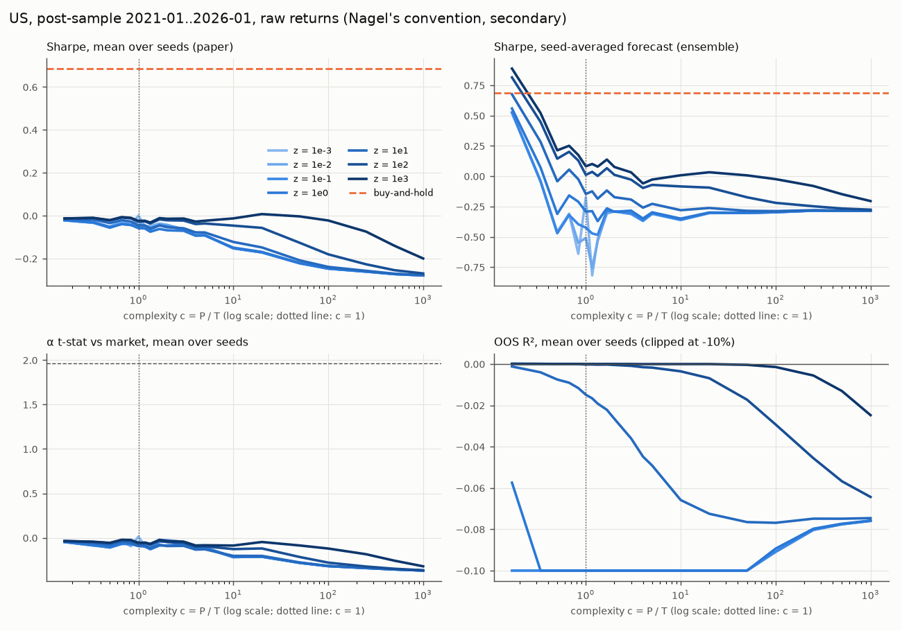
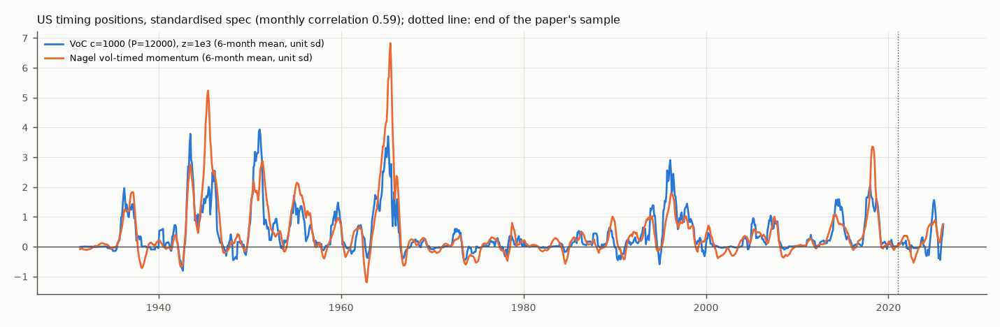
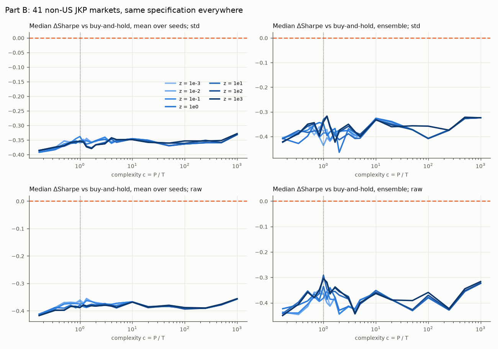
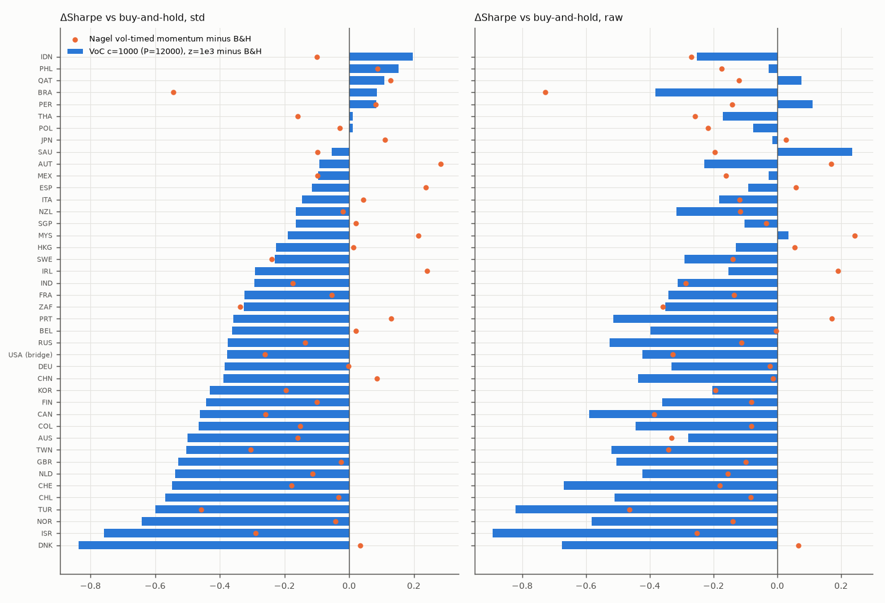

# Virtue of complexity, out of sample: after the paper's sample and across 41 countries

[](https://github.com/mohymabrouk/virtue-of-complexity-out-of-sample/actions/workflows/tests.yml)

Retests Kelly, Malamud & Zhou (*Journal of Finance*, 2024) after publication and in 41 non-US markets, on free data, CPU only.

## Headline


**No. In these tests the virtue of complexity does not survive outside its original sample.** Over the paper's
own sample (US, 1931-2020) our implementation of the published specification reproduces the *shape* of KMZ's
complexity curve but not its level: the c = 1000, z = 10³ strategy has a Sharpe of 0.31 (paper: 0.47) and an
alpha t-stat of 1.1 against the volatility-standardised market (paper: 2.9); only in raw-return terms do we
match the paper's alpha and information ratio (t 2.8, IR 0.29, vs 2.9 and 0.31). Scored once on the
61 months after the paper's sample (2021-01 to 2026-01), the same strategy earned a Sharpe of 0.00
against 0.58 for buy-and-hold (raw returns: -0.20 vs 0.69), with alpha t-stats of 0.1 and
-0.3: it sidestepped 2022, then gave the gain back and missed the 2024-25 rally. Across 41 non-US
markets, with the same specification on JKP predictors, it beat buy-and-hold in 7 countries (4
in raw returns) and had a significantly positive alpha in 1 (2), about what chance alone gives
(about 1); the pooled cross-country portfolio has an alpha t-stat of 0.2 (0.4). The simple
volatility-timed momentum rule that Nagel (2025) says VoC reduces to beat VoC in 31 of 41 countries.
And the rising Sharpe-complexity curve is mostly an averaging artefact: when the forecasts of the random draws
are averaged instead of their statistics, an average of 300 two-feature models matches the 12,000-feature Sharpe in the
standardised spec, and in raw returns the alpha stops improving beyond 24 features. Two caveats bound
the US conclusions: five years of post-sample data give only about 17% power to detect the paper's
information ratio, and our primary implementation does not hit the paper's in-sample Sharpe (the construction
below does, and fails after the sample too). The cross-country evidence depends on neither, and it points the
same way.

**The construction that reproduces the paper also fails after its sample.** With our engine unchanged, four data
choices that the paper does not pin down move the 1931-2020 Sharpe from 0.31 to 0.49
(alpha t 1.1 to 3.1; paper: 0.47 and 2.9): where the predictors' expanding standardisation
starts, the inflation publication lag, the market-return series, and std vs uncentred RMS for the return scale
(Replication, item 6). One of them uses CPI about two weeks before its release. Scored once on 2021-01 to
2025-12, that construction earned a Sharpe of -0.06 against 0.71 for buy-and-hold (alpha
t -0.4); ours earned -0.01 against 0.57 on the same 60 months.
Write-up: [research note (PDF)](paper/note.pdf).

*Correction, 2026-11-24.* An earlier version of this README said the paper's Sharpe is approached only with a
look-ahead volatility window (one that includes the forecast month: 0.46 here; nkonts' replication,
0.42). A third public replication (rrikrv) reaches it without one, and our engine on its data file
reproduces KMZ's Table 1. The look-ahead window matches the Sharpe but not the alpha, so that explanation is
withdrawn (`PLAN.md`, changes 14-16).




### What was tested

Kelly, Malamud & Zhou (KMZ), "The Virtue of Complexity in Return Prediction", *Journal of Finance* 79(1), 2024
(NBER w30217), time the US market with ridge regressions on up to 12,000 random Fourier features (RFF) of 15
Welch-Goyal predictors, trained on rolling 12-month windows: far more parameters than observations. They report a
higher out-of-sample Sharpe than simple models (0.47 at P = 12,000, z = 10³) although the OOS R² is often negative.

The specification is copied from the paper and fixed in `PLAN.md` before any result: T = 12, γ = 2,
ω ~ N(0, I), sin/cos pairs, every RFF divided by its training-window std, ridge without intercept,
P ∈ {2, ..., 12,000} (20 values), log₁₀ z ∈ {-3, ..., 3}, predictors divided by an expanding std, returns
divided by their trailing 12-month std, position = forecast. Nothing was tuned on any evaluation sample.

- **Part A**: the US, 1931-01 to 2020-12 (the paper's sample, replication), then the same specification scored
  once on the **61 months after the paper's sample ends (2021-01 to 2026-01)**, logged in
  `results/test_log.jsonl`.
- **Part B**: the same specification on 41 non-US equity markets from the Jensen-Kelly-Pedersen (JKP) data, with
  15 predictors built from JKP data (13 theme returns, the market return and its 12-month volatility).
- **Two return conventions.** *Standardised* = KMZ's specification (primary). *Raw* = raw excess returns for the
  target, the traded asset and the benchmark, as in Nagel (2025); it was added (and logged in `PLAN.md`) when
  the standardised version did not replicate, because it reproduces a number published from KMZ's own code.
- **Two ways to average over random seeds.** "Paper" = compute each statistic per RFF draw, then average
  (KMZ, step iv). "Ensemble" = average the forecasts over draws, then evaluate one strategy (the version an
  investor can trade, and the one Buncic (2025, as summarised by Nagel 2025) argues for). Part A uses
  300 draws, Part B 30 per country.
- **Baselines**: buy-and-hold, the historical mean, the linear kitchen-sink ridge on the same 15 predictors
  (ridgeless and z = 10⁻³...10³), the sign of the trailing 12-month return (TSMOM), the 12-month mean return,
  KMZ's own momentum rule (mean/var, appendix G) and Nagel's (2025) volatility-timed momentum (his eq. 14), the
  simple rule he argues VoC reduces to when T = 12.

## Main performance table (US)

Rows are strategies, columns the two periods. VoC rows use the seed-averaged forecast (one implementable strategy). Sharpe ratios are annualised, with a 95% CI from the Lo (2002) standard error with the Mertens (2002) skew/kurtosis correction. DSR = deflated Sharpe ratio (probability the true Sharpe beats the best of 153 trials: 140 VoC cells, 8 linear ridge cells, 5 simple rules). α t = OLS t-stat of the alpha in a regression on the same-convention market (iid, as in KMZ; Newey-West t-stats are in the CSVs). OOS R² = 1 - Σ(R-f)²/ΣR², shown only where the position is a return forecast.

**Standardised returns (KMZ's specification, primary).**

| Strategy | Sharpe [95% CI], 1931-2020 (n=1080) | DSR | α t | OOS R² | Sharpe [95% CI], 2021-01..2026-01 (n=61) | DSR | α t | OOS R² |
|---|---|---|---|---|---|---|---|---|
| Buy-and-hold | 0.53 [0.31, 0.74] | 1.00 | – | – | 0.58 [-0.33, 1.49] | 0.42 | – | – |
| Historical mean | 0.49 [0.27, 0.70] | 1.00 | -0.9 | 2.0% | 0.57 [-0.34, 1.49] | 0.42 | -1.5 | 2.7% |
| Linear ridge, z=0+ | -0.16 [-0.33, 0.00] | 0.00 | -1.9 | < -100% | -0.39 [-1.24, 0.46] | 0.01 | -0.9 | < -100% |
| Linear ridge, z=1e3 | 0.39 [0.18, 0.61] | 0.96 | 1.9 | -1.9% | 0.31 [-0.57, 1.19] | 0.21 | 0.1 | -3.1% |
| TSMOM sign | 0.40 [0.19, 0.61] | 0.96 | 2.1 | – | 0.47 [-0.42, 1.37] | 0.33 | 0.5 | – |
| Mom12 (equal weights) | 0.38 [0.16, 0.59] | 0.94 | 1.9 | -3.7% | 0.33 [-0.54, 1.21] | 0.23 | 0.2 | -4.0% |
| KMZ momentum (mean/var) | 0.33 [0.15, 0.51] | 0.92 | 1.1 | – | 0.23 [-0.65, 1.12] | 0.17 | -0.4 | – |
| Nagel vol-timed momentum | 0.32 [0.10, 0.54] | 0.84 | 1.1 | – | 0.04 [-0.83, 0.92] | 0.08 | -0.2 | – |
| VoC c=1 (P=12), z=1e3 | 0.18 [-0.06, 0.43] | 0.44 | 0.2 | 0.0% | 0.17 [-0.70, 1.04] | 0.13 | 0.3 | 0.0% |
| VoC c=10 (P=120), z=1e3 | 0.21 [-0.05, 0.46] | 0.51 | 0.4 | 0.2% | 0.12 [-0.74, 0.98] | 0.10 | 0.1 | 0.0% |
| VoC c=100 (P=1200), z=1e3 | 0.29 [0.04, 0.54] | 0.76 | 0.8 | 0.8% | 0.10 [-0.76, 0.96] | 0.10 | 0.2 | 0.0% |
| VoC c=1000 (P=12000), z=1e3 | 0.31 [0.08, 0.54] | 0.82 | 1.1 | 1.1% | 0.00 [-0.87, 0.87] | 0.06 | 0.1 | -1.5% |
| VoC c=1000 (P=12000), z=1e-3 | 0.30 [0.09, 0.51] | 0.81 | 1.3 | -0.4% | -0.06 [-0.93, 0.82] | 0.05 | 0.1 | -5.6% |

**Raw excess returns (Nagel's convention, secondary).**

| Strategy | Sharpe [95% CI], 1931-2020 (n=1080) | DSR | α t | OOS R² | Sharpe [95% CI], 2021-01..2026-01 (n=61) | DSR | α t | OOS R² |
|---|---|---|---|---|---|---|---|---|
| Buy-and-hold | 0.46 [0.25, 0.67] | 0.85 | – | – | 0.69 [-0.23, 1.60] | 0.38 | – | – |
| Historical mean | 0.40 [0.17, 0.64] | 0.68 | 1.6 | 1.1% | 0.68 [-0.23, 1.59] | 0.38 | -0.9 | 3.6% |
| Linear ridge, z=0+ | -0.12 [-0.28, 0.05] | 0.00 | -1.4 | < -100% | -0.44 [-1.19, 0.30] | 0.00 | -0.9 | < -100% |
| Linear ridge, z=1e3 | 0.27 [0.06, 0.49] | 0.25 | 3.0 | -2.0% | 0.51 [-0.36, 1.38] | 0.24 | 0.7 | -2.9% |
| TSMOM sign | 0.38 [0.17, 0.59] | 0.62 | 3.3 | – | 0.66 [-0.25, 1.57] | 0.36 | 1.1 | – |
| Mom12 (equal weights) | 0.15 [-0.08, 0.38] | 0.05 | 2.3 | -5.9% | 0.54 [-0.33, 1.40] | 0.26 | 0.8 | -4.6% |
| KMZ momentum (mean/var) | 0.40 [0.18, 0.61] | 0.66 | 3.0 | – | 0.36 [-0.52, 1.24] | 0.15 | 0.1 | – |
| Nagel vol-timed momentum | 0.44 [0.24, 0.64] | 0.82 | 3.6 | – | 0.15 [-0.73, 1.04] | 0.07 | 0.2 | – |
| VoC c=1 (P=12), z=1e3 | 0.33 [0.10, 0.55] | 0.43 | 2.5 | 0.0% | 0.08 [-0.80, 0.96] | 0.05 | 0.1 | 0.0% |
| VoC c=10 (P=120), z=1e3 | 0.42 [0.21, 0.63] | 0.75 | 3.0 | 0.1% | 0.01 [-0.86, 0.88] | 0.03 | -0.2 | 0.0% |
| VoC c=100 (P=1200), z=1e3 | 0.46 [0.25, 0.67] | 0.85 | 3.3 | 0.5% | -0.02 [-0.89, 0.84] | 0.03 | -0.1 | -0.1% |
| VoC c=1000 (P=12000), z=1e3 | 0.42 [0.22, 0.62] | 0.76 | 3.0 | 0.8% | -0.20 [-1.03, 0.63] | 0.01 | -0.3 | -2.4% |
| VoC c=1000 (P=12000), z=1e-3 | 0.38 [0.18, 0.59] | 0.62 | 2.9 | 0.3% | -0.29 [-1.09, 0.52] | 0.00 | -0.4 | -7.4% |

### Sharpe difference vs buy-and-hold (circular block bootstrap over months, 2,000 resamples)

Standardised:

| Strategy | ΔSharpe vs buy-and-hold, 1931-2020 [block-bootstrap 95% CI] | IR | ΔSharpe, 2021-01..2026-01 [CI] | IR |
|---|---|---|---|---|
| Historical mean | -0.04 [-0.09, +0.01] | -0.10 | -0.01 [-0.02, +0.00] | -0.67 |
| Linear ridge, z=0+ | -0.69 [-0.95, -0.39] | -0.20 | -0.97 [-2.18, +0.15] | -0.43 |
| Linear ridge, z=1e3 | -0.13 [-0.36, +0.10] | 0.20 | -0.27 [-0.90, +0.28] | 0.04 |
| TSMOM sign | -0.13 [-0.37, +0.11] | 0.22 | -0.11 [-0.71, +0.42] | 0.21 |
| Mom12 (equal weights) | -0.15 [-0.39, +0.09] | 0.20 | -0.25 [-0.91, +0.30] | 0.09 |
| KMZ momentum (mean/var) | -0.19 [-0.42, +0.04] | 0.12 | -0.35 [-0.87, +0.17] | -0.20 |
| Nagel vol-timed momentum | -0.21 [-0.44, +0.04] | 0.12 | -0.54 [-1.32, +0.20] | -0.11 |
| VoC c=1 (P=12), z=1e3 | -0.34 [-0.58, 0.00] | 0.02 | -0.41 [-1.81, +0.84] | 0.14 |
| VoC c=10 (P=120), z=1e3 | -0.32 [-0.56, +0.02] | 0.04 | -0.46 [-1.82, +0.62] | 0.05 |
| VoC c=100 (P=1200), z=1e3 | -0.23 [-0.47, +0.02] | 0.08 | -0.48 [-1.90, +0.67] | 0.07 |
| VoC c=1000 (P=12000), z=1e3 | -0.21 [-0.45, +0.02] | 0.11 | -0.59 [-2.16, +0.70] | 0.06 |
| VoC c=1000 (P=12000), z=1e-3 | -0.23 [-0.47, +0.02] | 0.14 | -0.64 [-2.27, +0.72] | 0.06 |

Raw:

| Strategy | ΔSharpe vs buy-and-hold, 1931-2020 [block-bootstrap 95% CI] | IR | ΔSharpe, 2021-01..2026-01 [CI] | IR |
|---|---|---|---|---|
| Historical mean | -0.05 [-0.22, +0.12] | 0.17 | -0.01 [-0.01, +0.00] | -0.41 |
| Linear ridge, z=0+ | -0.57 [-0.84, -0.26] | -0.14 | -1.13 [-2.20, 0.00] | -0.41 |
| Linear ridge, z=1e3 | -0.18 [-0.46, +0.10] | 0.32 | -0.17 [-0.91, +0.43] | 0.31 |
| TSMOM sign | -0.08 [-0.37, +0.22] | 0.35 | -0.03 [-0.71, +0.57] | 0.51 |
| Mom12 (equal weights) | -0.31 [-0.59, +0.02] | 0.24 | -0.15 [-0.93, +0.47] | 0.36 |
| KMZ momentum (mean/var) | -0.06 [-0.33, +0.20] | 0.32 | -0.32 [-0.92, +0.25] | 0.04 |
| Nagel vol-timed momentum | -0.02 [-0.28, +0.23] | 0.38 | -0.53 [-1.29, +0.19] | 0.07 |
| VoC c=1 (P=12), z=1e3 | -0.13 [-0.37, +0.13] | 0.27 | -0.60 [-1.88, +0.75] | 0.05 |
| VoC c=10 (P=120), z=1e3 | -0.04 [-0.28, +0.20] | 0.32 | -0.68 [-1.89, +0.43] | -0.07 |
| VoC c=100 (P=1200), z=1e3 | +0.00 [-0.23, +0.22] | 0.35 | -0.71 [-1.95, +0.48] | -0.07 |
| VoC c=1000 (P=12000), z=1e3 | -0.04 [-0.29, +0.18] | 0.32 | -0.89 [-2.20, +0.43] | -0.15 |
| VoC c=1000 (P=12000), z=1e-3 | -0.08 [-0.34, +0.17] | 0.31 | -0.97 [-2.30, +0.40] | -0.17 |


### What happened after 2020

Over the 61 post-sample months the target strategy (c = 1000, z = 10³) earned a Sharpe of 0.00
against 0.58 for buy-and-hold in the standardised specification (raw: -0.20 vs 0.69); its alpha
t-stat is 0.1 (raw -0.3). The year-by-year view below shows the mechanism. In 2022 it did what KMZ
describe: it was short in 8 of 12 months and its 2022 return was +4.6 (in units of its usual
position) against -5.6 for buy-and-hold. It then gave that back (its worst month, 2023-11, was a position of
-3.6× its usual size into a +2.0 sd market month) and held small positions through the 2024-25
rally. Nagel's volatility-timed
momentum, the simple rule the critique says VoC mimics, also lagged buy-and-hold (Sharpe 0.04). The
complexity curve after 2020 does not rise: with the paper's averaging, the Sharpe at z = 10³ stays between
-0.02 and 0.09 over the whole P grid; with ensemble averaging it *falls* with complexity.

| Year | months | mean VoC position / its 1931-2020 mean | months long | buy-and-hold return (sum, standardised units) | VoC return (sum, in units of its mean absolute position) |
|---|---|---|---|---|---|
| 2021 | 12 | +0.39 | 10/12 | +4.59 | +1.18 |
| 2022 | 12 | -0.27 | 4/12 | -5.55 | +4.58 |
| 2023 | 12 | +0.01 | 5/12 | +3.60 | -7.45 |
| 2024 | 12 | +1.39 | 8/12 | +4.13 | +0.51 |
| 2025 | 12 | +0.83 | 7/12 | +3.16 | +1.05 |
| 2026 | 1 | +0.13 | 1/1 | +0.31 | +0.03 |

## Replication

| Quantity (1931-2020, T=12) | Published | Ours, standardised (primary) | Ours, raw returns |
|---|---|---|---|
| VoC P=12000, z=10³: Sharpe (mean over seeds) | 0.47 | 0.31 | 0.38 |
| VoC P=12000, z=10³: α t-stat (mean over seeds) | 2.9 | 1.1 | 2.8 |
| VoC P=12000, z=10³: information ratio | 0.31 | 0.11 | 0.29 |
| VoC P=12000, z=10³: OOS R² (mean over seeds) | 0.6% | 1.0% | – |
| VoC P=12000, ridgeless (z=10⁻³): α t / IR (mean over seeds) | Nagel (raw, KMZ code): 2.42 / 0.26; KMZ Fig. 8 (std): 2.81 / 0.30 | 1.26 / 0.13 | 2.57 / 0.27 |
| Linear ridge z=10³: Sharpe / α t (no seeds involved) | 0.46 / 3.1 | 0.39 / 1.9 | 0.27 / 3.0 |
| Linear ridgeless (kitchen sink): Sharpe | -0.11 | -0.16 | -0.12 |
| Nagel vol-timed momentum: α t / IR (raw) | Nagel Table I: 3.68 / 0.39 | – | 3.60 / 0.38 |


**Target, fixed in `PLAN.md` before any result:** KMZ Table 1, Panel A, "Nonlinear" (T = 12, P = 12,000,
z = 10³), Sharpe 0.47 computed the paper's way (per-draw Sharpe averaged over draws), tolerance ±0.10.
**Ours: 0.31 (seed sd 0.017, 300 draws). Not matched.**
Test 6 (`tests/test_replication.py::test_replication_target_sharpe`) is therefore marked `xfail(strict=True)`;
its tolerance was not changed.

What we checked (all on 1931-2020 only, scripts in `scripts/diag_*.py`, log in `PLAN.md`):

1. The batched dual engine equals a direct primal ridge on the same windows, to 1e-8.
2. **The data match Nagel's.** His volatility-timed momentum rule, rebuilt from our predictors, gives alpha
   t 3.60 and IR 0.38 against his 3.68 and 0.39.
3. **The RFF machine matches KMZ's code in raw-return terms.** With raw excess returns our ridgeless
   P = 12,000 strategy has alpha t 2.57 and IR 0.27;
   Nagel reports 2.42 and 0.26 from KMZ's own replication code (a second test checks this within ±0.5 / ±0.06,
   and passes). At z = 10³ the raw version gives alpha t 2.76 and IR
   0.29, close to KMZ's published 2.9 and 0.31.
4. **Changing the return scaling alone does not close the gap.** Dividing returns by their trailing 12-month std
   (as the paper describes) turns buy-and-hold into a volatility-managed market with a Sharpe of 0.53 over
   1931-2020 (raw: 0.46). Against that benchmark our VoC strategy has a Sharpe of
   0.31 and an alpha t of only 1.1. Variants of the
   std window (`results/replication_diagnostics.json`, 3 draws each) do not close the gap: one more month of lag
   gives a VoC (z = 10³) Sharpe of 0.29, a root-mean-square instead of a std 0.35. A window that
   includes the forecast month (look-ahead, so not adopted) gives 0.46, and it reproduces two of KMZ's
   linear numbers (ridgeless Sharpe -0.11 vs -0.11; z = 10³ alpha t 3.1 vs 3.1) but not the
   rest (linear z = 10³ Sharpe 0.60 vs 0.46; VoC alpha t 1.9 vs 2.9): a partial match.
   It caps crash months (with the month in its own scale, an extreme return tends to ±√12 ≈ ±3.5 whatever its
   size), which lifts buy-and-hold too.
5. **One public replication uses the look-ahead window.** [nkonts' replication](https://github.com/nkonts/replication-the-virtue-of-complexity-in-return-prediction)
   (commit `40ab1c8`) standardises with `returns_std = returns.rolling(12).std()` and
   `returns = returns / returns_std`, then targets `returns.shift(-1)`. The forecast made in month t is therefore
   scored on R(t+1) divided by a std that includes R(t+1). Averaged over its 500 draws at P = 12,000,
   z = 10³, it reports a Sharpe of 0.42, with buy-and-hold at 0.64 (S&P price returns,
   Welch-Goyal data to 2021). That is our look-ahead variant's convention (0.46), closer to the paper's
   0.47 than our lagged version (0.31), but item 4 shows it matches the Sharpe and not
   the alpha, and item 6 shows it is not needed. Source: `results/external_replication_check.json`, written by
   `scripts/external_replication_check.py`.
6. **The gap is in four data-construction choices (added 2026-11-24, PLAN.md changes 14-16).** A third public
   replication, [rrikrv](https://github.com/rrikrv/voc-replication) (commit `9c77321`), reaches the paper's numbers without a look-ahead
   window. Our unchanged engine on its committed data file gives a VoC Sharpe of 0.49, alpha t
   3.1 and IR 0.33, and linear z = 10³ 0.46 / alpha t 3.1, ridgeless
   -0.11 (10 draws; `results/external_data_diagnostic.json`, written by
   `scripts/diag_external_data.py`, which reads the file and runs none of its code). Swapping only its returns
   into our data gives 0.36, only its predictors 0.40. Rebuilding its four data choices from our
   own raw files and adding them one at a time (`scripts/construction_b.py`, `results/construction_b.json`)
   locates the whole gap:

| Data construction (same engine; P = 12,000, z = 10³, 1931-2020, 10 draws) | VoC Sharpe | VoC α t | VoC IR | Linear z = 10³ Sharpe | Linear α t | Buy-and-hold Sharpe |
|---|---|---|---|---|---|---|
| A: ours, pre-registered (frozen) | 0.31 | 1.0 | 0.11 | 0.39 | 1.9 | 0.53 |
| + (i) predictor std from each series' first month in the Goyal file | 0.34 | 1.3 | 0.14 | 0.39 | 1.9 | 0.53 |
| + (ii) inflation not lagged (uses CPI about two weeks before its release) | 0.38 | 1.6 | 0.18 | 0.39 | 1.9 | 0.53 |
| + (iii) S&P 500 return from the Goyal file instead of French Mkt-RF | 0.42 | 2.1 | 0.23 | 0.42 | 2.3 | 0.52 |
| + (iv) uncentred RMS return volatility instead of std = **B** | 0.49 | 3.1 | 0.33 | 0.46 | 3.1 | 0.51 |
| rrikrv's data file, our engine | 0.49 | 3.1 | 0.33 | 0.46 | 3.1 | 0.51 |
| KMZ, Table 1 | 0.47 | 2.9 | 0.31 | 0.46 | 3.1 | – |

   Each step adds 0.03 to 0.07; none closes the gap alone. Steps (i), (iii) and (iv) use only past data. Step (ii)
   does not: CPI for month t is released during month t+1, which is why Welch and Goyal lag it and construction A
   does too. The paper's text ("trailing 12-month return standard deviation", "expanding window historical standard
   deviation", "the CRSP value-weighted index") fits A at least as well as B, so neither is "the" paper's
   construction; the point is that the headline number moves from 0.31 to 0.49 with them, while
   KMZ write that "none of our findings are sensitive to variations in how standardizations are implemented".
   With 300 draws, construction B gives 0.49 (alpha t 3.1, IR 0.33) on
   1931-2020; its post-sample score is in the headline.

Hence the two conventions in every table: the standardised one is the paper's text as we read it (construction A);
the raw one reproduces numbers obtained with the authors' code. Construction B, which reproduces the published
standardised numbers, was added after the frozen runs and is reported separately (headline and item 6).

## Complexity curves


Each figure has four panels: Sharpe with the paper's averaging (per-draw Sharpe averaged over draws), Sharpe of
the seed-averaged forecast, the alpha t-stat and the OOS R², each against complexity c = P/T on a log scale,
one line per ridge penalty z (light to dark blue: 10⁻³ to 10³). The dashed orange line is buy-and-hold.
The full grid (140 cells, both conventions, both averaging schemes) is in `results/partA_paper_curve.csv` and
`results/partA_post_curve.csv`; `results/tables.md` lists the z = 10³ and z = 10⁻³ columns.











## Part B: the same specification on 41 non-US markets


Data: JKP global factor data (jkpfactors.com, no login), capped value-weighted market excess returns in USD and
the 13 theme factor returns, monthly, to 2025-12. Predictors (fixed in `PLAN.md` before any run): the 13 theme
returns of month t, the market return of month t and its trailing 12-month volatility. A country is used on its
longest run of consecutive months with all 13 themes, a market return and at least 10 stocks, and is kept if at
least 120 out-of-sample months remain: 41 non-US countries (AUS, AUT, BEL, BRA, CAN, CHE, CHL, CHN, COL, DEU, DNK, ESP, FIN, FRA, GBR, HKG, IDN, IND, IRL, ISR, ITA, JPN, KOR, MEX, MYS, NLD, NOR, NZL, PER, PHL, POL, PRT, QAT, RUS, SAU, SGP, SWE, THA, TUR, TWN, ZAF). Same T, γ, P grid and z grid for
every country; 30 RFF draws per country. The US is run with the same JKP recipe as a bridge and is excluded
from the non-US statistics. "Beats B&H" counts countries whose strategy Sharpe exceeds that country's buy-and-hold
Sharpe. Each country's sample is its full available history (mostly the 1990s to 2025), so Part B is out of sample
in space (KMZ used no country but the US), not in time.

**Standardised returns.**

| Strategy | Sharpe: median [IQR] | median ΔSharpe vs B&H | beats B&H | median α t | α t > 1.96 / < -1.96 | median OOS R² |
|---|---|---|---|---|---|---|
| Buy-and-hold | 0.35 [0.29, 0.41] | +0.00 | – | – | – | – |
| Historical mean | 0.23 [0.13, 0.31] | -0.11 | 2/41 | -1.05 | 0 / 7 | 0.1% |
| Linear ridge, z=0+ | -0.03 [-0.15, 0.11] | -0.34 | 0/41 | -0.08 | 0 / 0 | < -100% |
| Linear ridge, z=1e3 | 0.16 [0.01, 0.26] | -0.17 | 7/41 | 0.43 | 4 / 1 | 0.2% |
| TSMOM sign | 0.23 [0.12, 0.31] | -0.17 | 7/41 | 0.80 | 4 / 1 | – |
| Mom12 (equal weights) | 0.22 [0.09, 0.30] | -0.17 | 6/41 | 0.69 | 3 / 1 | -6.4% |
| KMZ momentum (mean/var) | 0.30 [0.21, 0.42] | -0.05 | 14/41 | 0.85 | 3 / 0 | – |
| Nagel vol-timed momentum | 0.31 [0.13, 0.41] | -0.04 | 15/41 | 1.31 | 6 / 0 | – |
| VoC c=1 (P=12), z=1e3 | 0.03 [-0.15, 0.17] | -0.34 | 4/41 | -0.06 | 0 / 1 | 0.0% |
| VoC c=10 (P=120), z=1e3 | 0.04 [-0.11, 0.12] | -0.33 | 3/41 | 0.05 | 1 / 0 | 0.0% |
| VoC c=100 (P=1200), z=1e3 | -0.03 [-0.14, 0.14] | -0.36 | 5/41 | -0.06 | 1 / 1 | 0.0% |
| VoC c=1000 (P=12000), z=1e3 | 0.06 [-0.12, 0.23] | -0.32 | 7/41 | -0.02 | 1 / 0 | 0.0% |
| VoC c=1000 (P=12000), z=1e-3 | 0.06 [-0.12, 0.23] | -0.32 | 7/41 | -0.05 | 1 / 0 | 0.0% |

| VoC c=1000 (P=12000), z=1e3 has a higher Sharpe than ... | countries | sign-test p (two-sided) |
|---|---|---|
| Buy-and-hold | 7/41 | 0.000 |
| Linear ridge, z=1e3 | 11/41 | 0.004 |
| Linear ridge, z=0+ | 24/41 | 0.349 |
| TSMOM sign | 11/41 | 0.004 |
| Mom12 (equal weights) | 12/41 | 0.012 |
| Nagel vol-timed momentum | 10/41 | 0.001 |
| KMZ momentum (mean/var) | 7/41 | 0.000 |
| VoC c=1 (P=12), z=1e3 | 26/41 | 0.117 |

Pooled, equal-weighted across the non-US countries available each month (1995-10 to 2025-12):

| Strategy (equal-weighted across non-US countries) | Sharpe [95% CI] | DSR (13 trials) | α t vs EW B&H | ΔSharpe vs EW B&H [CI] |
|---|---|---|---|---|
| Buy-and-hold | 0.49 [0.11, 0.87] | 0.63 | – | – |
| Historical mean | 0.42 [0.04, 0.80] | 0.48 | -1.0 | -0.08 [-0.20, +0.04] |
| Linear ridge, z=0+ | -0.11 [-0.46, 0.24] | 0.00 | -0.6 | -0.61 [-1.20, -0.03] |
| Linear ridge, z=1e3 | 0.42 [0.07, 0.77] | 0.49 | 1.9 | -0.07 [-0.60, +0.43] |
| TSMOM sign | 0.46 [0.11, 0.81] | 0.57 | 2.1 | -0.03 [-0.59, +0.50] |
| Mom12 (equal weights) | 0.45 [0.10, 0.80] | 0.54 | 2.0 | -0.05 [-0.61, +0.48] |
| KMZ momentum (mean/var) | 0.63 [0.29, 0.96] | 0.88 | 2.5 | +0.13 [-0.28, +0.55] |
| Nagel vol-timed momentum | 0.56 [0.21, 0.91] | 0.77 | 2.7 | +0.07 [-0.41, +0.54] |
| VoC c=1 (P=12), z=1e3 | -0.12 [-0.48, 0.23] | 0.00 | -0.8 | -0.62 [-1.20, -0.07] |
| VoC c=10 (P=120), z=1e3 | 0.15 [-0.21, 0.51] | 0.07 | 0.3 | -0.34 [-0.81, +0.06] |
| VoC c=100 (P=1200), z=1e3 | 0.09 [-0.27, 0.45] | 0.03 | -0.2 | -0.40 [-0.87, +0.03] |
| VoC c=1000 (P=12000), z=1e3 | 0.17 [-0.19, 0.53] | 0.08 | 0.2 | -0.33 [-0.81, +0.11] |
| VoC c=1000 (P=12000), z=1e-3 | 0.11 [-0.25, 0.47] | 0.04 | -0.1 | -0.39 [-0.89, +0.09] |

**Raw returns.**

| Strategy | Sharpe: median [IQR] | median ΔSharpe vs B&H | beats B&H | median α t | α t > 1.96 / < -1.96 | median OOS R² |
|---|---|---|---|---|---|---|
| Buy-and-hold | 0.38 [0.32, 0.44] | +0.00 | – | – | – | – |
| Historical mean | 0.30 [0.18, 0.37] | -0.09 | 3/41 | -1.06 | 0 / 5 | 0.4% |
| Linear ridge, z=0+ | -0.06 [-0.17, 0.13] | -0.43 | 1/41 | -0.11 | 0 / 0 | < -100% |
| Linear ridge, z=1e3 | 0.07 [-0.04, 0.22] | -0.29 | 4/41 | 0.48 | 3 / 0 | 0.0% |
| TSMOM sign | 0.16 [0.04, 0.22] | -0.24 | 2/41 | 0.80 | 2 / 1 | – |
| Mom12 (equal weights) | 0.08 [0.01, 0.15] | -0.31 | 1/41 | 0.66 | 0 / 0 | -8.9% |
| KMZ momentum (mean/var) | 0.31 [0.21, 0.39] | -0.05 | 14/41 | 1.37 | 7 / 0 | – |
| Nagel vol-timed momentum | 0.26 [0.09, 0.35] | -0.14 | 8/41 | 1.64 | 12 / 0 | – |
| VoC c=1 (P=12), z=1e3 | 0.07 [-0.08, 0.18] | -0.30 | 3/41 | 0.36 | 1 / 2 | 0.0% |
| VoC c=10 (P=120), z=1e3 | 0.01 [-0.10, 0.09] | -0.36 | 2/41 | -0.01 | 1 / 0 | 0.0% |
| VoC c=100 (P=1200), z=1e3 | 0.02 [-0.19, 0.17] | -0.36 | 3/41 | 0.09 | 2 / 1 | 0.0% |
| VoC c=1000 (P=12000), z=1e3 | 0.08 [-0.11, 0.19] | -0.32 | 4/41 | 0.32 | 2 / 0 | 0.0% |
| VoC c=1000 (P=12000), z=1e-3 | 0.08 [-0.11, 0.18] | -0.32 | 3/41 | 0.31 | 2 / 0 | 0.0% |

| VoC c=1000 (P=12000), z=1e3 has a higher Sharpe than ... | countries | sign-test p (two-sided) |
|---|---|---|
| Buy-and-hold | 4/41 | 0.000 |
| Linear ridge, z=1e3 | 18/41 | 0.533 |
| Linear ridge, z=0+ | 26/41 | 0.117 |
| TSMOM sign | 16/41 | 0.211 |
| Mom12 (equal weights) | 20/41 | 1.000 |
| Nagel vol-timed momentum | 11/41 | 0.004 |
| KMZ momentum (mean/var) | 8/41 | 0.000 |
| VoC c=1 (P=12), z=1e3 | 24/41 | 0.349 |

Pooled (1995-10 to 2025-12):

| Strategy (equal-weighted across non-US countries) | Sharpe [95% CI] | DSR (13 trials) | α t vs EW B&H | ΔSharpe vs EW B&H [CI] |
|---|---|---|---|---|
| Buy-and-hold | 0.49 [0.10, 0.87] | 0.73 | – | – |
| Historical mean | 0.40 [0.02, 0.78] | 0.56 | -1.1 | -0.09 [-0.21, +0.04] |
| Linear ridge, z=0+ | -0.16 [-0.50, 0.18] | 0.00 | -0.5 | -0.65 [-1.24, -0.04] |
| Linear ridge, z=1e3 | 0.19 [-0.16, 0.55] | 0.17 | 1.6 | -0.29 [-0.93, +0.34] |
| TSMOM sign | 0.27 [-0.08, 0.63] | 0.31 | 2.0 | -0.21 [-0.90, +0.49] |
| Mom12 (equal weights) | 0.15 [-0.21, 0.52] | 0.13 | 1.6 | -0.33 [-1.05, +0.36] |
| KMZ momentum (mean/var) | 0.59 [0.24, 0.94] | 0.89 | 2.9 | +0.10 [-0.46, +0.65] |
| Nagel vol-timed momentum | 0.40 [0.06, 0.74] | 0.58 | 2.8 | -0.09 [-0.67, +0.48] |
| VoC c=1 (P=12), z=1e3 | -0.01 [-0.37, 0.35] | 0.02 | 0.0 | -0.49 [-1.10, +0.01] |
| VoC c=10 (P=120), z=1e3 | 0.09 [-0.27, 0.46] | 0.07 | 0.6 | -0.39 [-0.98, +0.17] |
| VoC c=100 (P=1200), z=1e3 | 0.06 [-0.30, 0.41] | 0.04 | 0.2 | -0.43 [-0.99, +0.10] |
| VoC c=1000 (P=12000), z=1e3 | 0.09 [-0.27, 0.45] | 0.07 | 0.4 | -0.39 [-0.91, +0.11] |
| VoC c=1000 (P=12000), z=1e-3 | 0.06 [-0.30, 0.42] | 0.05 | 0.3 | -0.42 [-0.95, +0.08] |

**Bridge: the US with JKP predictors** (same 15-predictor recipe as the other countries), next to the Welch-Goyal model of Part A on the same months.

| Strategy | JKP predictors, std | JKP predictors, raw | Welch-Goyal predictors, std | Welch-Goyal predictors, raw |
|---|---|---|---|---|
| Buy-and-hold | 0.40 (α t –) | 0.45 (α t –) | 0.44 (α t –) | 0.48 (α t –) |
| Linear ridge, z=1e3 | -0.06 (α t -1.3) | -0.10 (α t -0.7) | 0.27 (α t 1.1) | 0.23 (α t 1.7) |
| Nagel vol-timed momentum | 0.14 (α t 0.3) | 0.13 (α t 1.1) | 0.14 (α t 0.0) | 0.20 (α t 1.3) |
| VoC c=1000 (P=12000), z=1e3 | 0.02 (α t -0.2) | 0.03 (α t -0.1) | 0.23 (α t 0.6) | 0.22 (α t 1.0) |

Same months for all four columns: 1956-10 to 2025-12 (831 months).






**Reading Part B.** Across the 41 countries the c = 1000, z = 10³ strategy has a median Sharpe of
0.06 against 0.35 for buy-and-hold (standardised) and loses to buy-and-hold in 34 of them.
More complexity does not help: the cross-country median Sharpe gap to buy-and-hold is negative in every one of
the 140 (P, z) cells, under both averaging schemes and both conventions (the best cell is -0.29;
first figure above). Pooled across countries the strategy has a Sharpe of 0.17 against 0.49
(ΔSharpe -0.33, 95% CI [-0.81, +0.11]). The rules built on recent returns do better
than VoC: Nagel's vol-timed momentum beats it in 31 of 41 countries (30 in raw returns),
and in the pooled portfolio Nagel's rule and KMZ's own momentum rule have alpha t-stats of 2.7 and
2.5, though their Sharpe gains over buy-and-hold (+0.07, +0.13) are not significant. The US
bridge shows that the predictor set matters, and so does the period: on the same 1956-2025 months, VoC with
Welch-Goyal predictors has a Sharpe close to the linear ridge and well below buy-and-hold, and with JKP predictors
it is near zero.


## What is new

1. **A true out-of-sample test of the published specification.** KMZ's sample ends in 2020-12; the same
   pre-registered model, with the same random draws, was scored once on 2021-01 to 2026-01 (logged before the
   result was seen). Neither KMZ nor Nagel (2025) could do this.
2. **A cross-country test with one fixed specification.** 41 non-US markets, no per-country tuning, with
   the same baselines, distribution, head-to-head counts and a pooled portfolio.
3. **Both ways of averaging over random draws on the same draws.** The rising "virtue of complexity" curve in
   the Sharpe ratio appears when per-draw statistics are averaged (the paper's step iv), because single
   low-P draws are noisy. When the forecasts of the same draws are averaged first, models with a handful of
   features already earn what P = 12,000 earns: over 1931-2020 the standardised ensemble with P = 2 and
   z = 10⁻³ has a Sharpe of 0.30 against 0.30 at P = 12,000; in raw returns the ensemble alpha
   t-stat at z = 10³ is 2.9 at P = 24 and 3.0 at P = 12,000. This is the point Nagel (2025)
   attributes to Buncic (2025), checked here directly.
4. **The critique's simple rule, scored out of sample too.** Nagel's volatility-timed momentum is a baseline in
   every table, including the post-sample window and every country.
5. **A located replication gap.** With the engine held fixed, four data-construction choices that the paper does
   not pin down move the headline Sharpe from about 0.31 to 0.49 (Replication, item 6), and the construction that
   reproduces the paper was scored once after its sample too. A look-ahead volatility window, used by one public
   replication, matches the Sharpe but not the alpha. Write-up: [`paper/note.pdf`](paper/note.pdf).


## Related work (2025-2026)

- **Nagel (2025)**, [NBER w34104](https://www.nber.org/papers/w34104): with T = 12, the RFF forecasts are close to
  volatility-timed momentum; his Appendix A shows that scaling the target by a lagged volatility can itself create
  spurious predictability. His rule is a baseline in every table here, including after 2020 and in 41 countries.
- **Buncic (2025)**, [SSRN 5239006](https://papers.ssrn.com/sol3/papers.cfm?abstract_id=5239006): the result rests on
  the zero-intercept restriction and on averaging performance measures across random draws. The "paper" vs
  "ensemble" averaging comparison in this repo tests the second point on the same draws.
- **Cartea, Jin & Shi (2025)**, [SSRN 5202064](https://papers.ssrn.com/sol3/papers.cfm?abstract_id=5202064):
  measurement error in the predictors caps the benefit of complexity. Cartea & Shi (2025),
  [SSRN 5930257](https://papers.ssrn.com/sol3/papers.cfm?abstract_id=5930257): random-feature gains can be mechanical.
- **Fallahgoul (2025)**, [arXiv 2506.03780](https://arxiv.org/abs/2506.03780): within-window standardisation changes
  the kernel the RFF approximate; learnability bounds that 12-month windows do not meet.
- **Guo, Huang, Li & Yu (2026)**, [arXiv 2608.23761](https://arxiv.org/abs/2608.23761): ridge and ridgeless RFF
  models do not beat the historical mean; their return scaling (uncentred second moment) is step (iv) of
  construction B.
- This repo adds what those papers could not: a test after the paper's sample, 41 countries, and a decomposition
  of the replication gap into data choices with the engine held fixed.


## Limits

- **The post-sample window is short: 61 months (5.1 years).** The standard error of an annualised
  Sharpe ratio over 61 months is about 0.44. If the true information ratio were KMZ's 0.31, the chance of
  an alpha t-stat above 1.645 (5%, one-sided) in 5.1 years is only 17%; the smallest IR detectable
  with 80% power is about 1.1. A post-sample "failure" is therefore weak evidence on its own; what the
  window can show is whether the strategy behaved as advertised (sign of the alpha, size of the Sharpe gap,
  behaviour in 2022), not whether it is significant. The window after the JF publication alone (2024-01 to
  2026-01, 25 months) is reported in the CSVs only.
- **Replication not matched in the primary construction** (Sharpe 0.31 vs 0.47; see "Replication"). The
  post-sample and Part B results of the standardised spec are those of *our* construction of the paper's data.
  Construction B reproduces the paper and was scored after its sample too (headline); it was defined after the
  frozen runs, and one of its four choices (unlagged inflation) is not real-time. Part B was not rerun with B's
  choices: (i)-(iii) are Welch-Goyal-specific, and the effect of (iv) on the 41 countries is untested.
- **Part B is a different predictor set.** It tests "the same machine on comparable inputs", not KMZ's exact
  model; the US-with-JKP-predictors bridge shows how much the predictor change matters on its own.
- **Countries are not independent.** Equity markets co-move, so 41 countries are worth fewer than 41
  independent tests; the sign tests treat them as independent and overstate precision.
- **Deflated Sharpe** uses the 153 strategies reported per period as the trial family. Earlier diagnostic runs
  on the paper sample (logged in `PLAN.md`) are not counted.
- **Fewer RFF draws than the paper** (see Simplifications); this matters little at high complexity, where the
  conclusions are drawn.


## Simplifications and deviations from the paper

All are logged with dates in `PLAN.md`.

1. **Market return**: Ken French's Mkt-RF (CRSP value-weighted excess return) instead of CRSP pulled from WRDS.
2. **Predictor vintage**: Goyal's 2025 file (data to 2025-12), not KMZ's vintage; Welch-Goyal (2008) log
   definitions for dp, dy, ep, de; inflation lagged one extra month (Welch-Goyal convention; KMZ do not say).
3. **Seeds**: 300 RFF draws in Part A and 30 per country in Part B instead of KMZ's 1,000 (2 of the
   laptop's 8 cores were available). At P ≥ 1,200 the seed-to-seed spread of the Sharpe is small (see the
   `sharpe_seed_sd` column of the curve CSVs), so the averages are precise there; the low-P "paper" curve is noisier.
4. **P grid**: 20 values from 2 to 12,000 (the paper does not list its exact grid).
5. **RFF std** uses ddof = 0 (numpy default); with ddof = 1 every z would be multiplied by 12/11.
6. **Secondary raw-return convention** added after the replication gap was found (see "Replication").
7. **Only T = 12** (the paper's main case); T = 60 and 120 are not run.
8. **No transaction costs, no leverage limits**: positions are the raw forecasts, as in the paper.
9. **Part B predictors** are JKP-based, not Welch-Goyal (which exist only for the US).


## How to run

```bash
git clone https://github.com/mohymabrouk/virtue-of-complexity-out-of-sample.git
cd virtue-of-complexity-out-of-sample
uv sync
export PYTHONIOENCODING=utf-8 OMP_NUM_THREADS=2 MKL_NUM_THREADS=2 OPENBLAS_NUM_THREADS=2
uv run python -m voc.cli download    # raw files into ~/.cache/quant-research/p2/raw (never re-downloaded)
uv run python -m voc.cli build       # panels + Part B country selection
uv run python -m voc.cli replicate   # Part A, paper sample (data cut at 2020-12), ~15 min
uv run python -m voc.cli test        # Part A, post-sample; runs once (a rerun needs --force and is logged), ~1 min
uv run python -m voc.cli global      # Part B, all countries, ~19 min
uv run python -m voc.cli report      # tables.md, figures, README.md
uv run pytest                        # tests
```

The post-sample test ran once, finishing at 2026-11-21T22:45:55+00:00 (config hash `c737047adb5c40f4`, code hash `eb3e44ded8f11321`); see
`results/test_log.jsonl`. Times are with 2 cores while other jobs shared the machine.


## Files

- `PLAN.md`: the pre-registered design and the log of every change during the build.
- `src/voc/`: `config.py` (every constant), `download.py`, `data.py` (panels, scaling), `model.py` (RFF, dual
  ridge, baselines), `metrics.py` (statistics; `sharpe` and `deflated_sharpe` copied from Alpha Audit),
  `pipeline.py` (stages), `report.py`, `readme.py`, `readme_text.py`.
- `tests/`: the six required tests (ridge, RFF, leak, strategy, metrics, replication) and helpers.
- `scripts/`: `thin_slice.py` (first end-to-end check), `diag_*.py` (exploratory replication diagnostics,
  paper sample only), `replication_diagnostics.py` (the same checks, written to
  `results/replication_diagnostics.json`), `external_replication_check.py` (reads nkonts' public replication,
  writes `results/external_replication_check.json`), `diag_external_data.py` (runs our engine on rrikrv's data file,
  writes `results/external_data_diagnostic.json`) and `construction_b.py` (the four-step decomposition and
  construction B's post-sample score, `results/construction_b.json`, `results/construction_b_post_positions.csv`).
- `paper/`: the research note (`note.tex`, `refs.bib`, compiled `note.pdf`); `numbers.json` / `numbers.tex` are
  written from `results/` by `python -m voc.note`, so the note types no number in.
- `results/`: `tables.md`, `partA_*` (tables, complexity curves, positions), `partB_*` (per-country tables,
  curves, strategy returns, pooled table, country selection), `replication_check.json`, `test_log.jsonl`,
  `replication_diagnostics.json`, `data_manifest.json` (URLs, sizes, SHA-256, download dates), figures `fig_*.png`.


## Sources

- Kelly, B., Malamud, S. and Zhou, K. (2024), "The Virtue of Complexity in Return Prediction", *Journal of
  Finance* 79(1), 459-503; NBER Working Paper 30217 (read:
  https://www.nber.org/system/files/working_papers/w30217/w30217.pdf).
- Nagel, S. (2025), "Seemingly Virtuous Complexity in Return Prediction", NBER Working Paper 34104 (read:
  https://www.nber.org/system/files/working_papers/w34104/w34104.pdf).
- Buncic, D. (2025), "Simplified: A Closer Look at the Virtue of Complexity in Return Prediction", Stockholm
  University working paper, SSRN 5239006. Not read in full (SSRN refuses automated access); cited for its abstract
  and for the point Nagel (2025) attributes to it.
- Guo, H., Huang, J., Li, R. and Yu, Y. (2026), "(Mis)Understanding Benign Overfitting in Equity Return
  Prediction", arXiv 2608.23761 (read). Cartea, Á., Jin, Q. and Shi, Y. (2025), SSRN 5202064; Cartea, Á. and
  Shi, Y. (2025), SSRN 5930257; Fallahgoul, H. (2025), arXiv 2506.03780 (abstracts read).
- Public replications whose data or code were read (none executed): nkonts (commit 40ab1c8) and rrikrv
  (commit 9c77321).
- Welch, I. and Goyal, A. (2008), *Review of Financial Studies* 21(4); data: Amit Goyal's website
  (https://sites.google.com/view/agoyal145), file "All data up to 2025".
- Jensen, T., Kelly, B. and Pedersen, L. (2023), "Is There a Replication Crisis in Finance?", *Journal of
  Finance*; data: https://jkpfactors.com (downloaded 2026-11-21, files `[all_countries]_[mkt]_[monthly]_[vw_cap]`
  and `[all_countries]_[all_themes]_[monthly]_[vw_cap]`).
- Kenneth French data library, `F-F_Research_Data_Factors` (built from the 202609 CRSP file).
- Lo, A. (2002), "The Statistics of Sharpe Ratios", *Financial Analysts Journal*; Mertens, E. (2002);
  Bailey, D. and López de Prado, M. (2014), "The Deflated Sharpe Ratio"; Moskowitz, T., Ooi, Y. and
  Pedersen, L. (2012), "Time Series Momentum".
